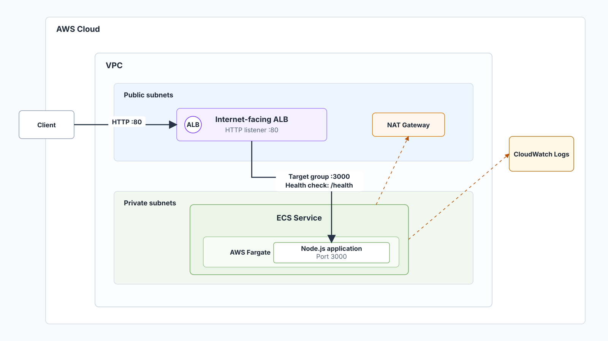
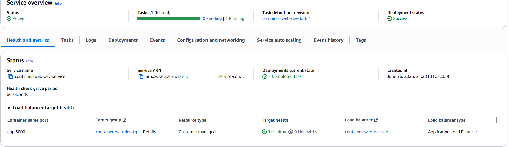

# ECS Fargate Container Delivery

[](https://github.com/hongzz0618/aws-containerized-web-app/actions/workflows/ci.yml)

A Terraform reference project that runs a small Node.js and TypeScript service on AWS ECS Fargate. It covers private task networking, digest-pinned image delivery, and basic runtime operations. [AWS deployment and teardown evidence](docs/deployment-validation.md).

## Architecture



`Client → public ALB (HTTP:80) → IP target group → private Fargate task (HTTP:3000)`

The ALB security group accepts public IPv4 traffic on TCP port 80. The task security group accepts port 3000 only from the ALB security group, including the target group's `GET /health` checks, which expect HTTP 200. Tasks have no public IP because the ALB reaches their private IPs. The NAT gateway gives tasks outbound access for ECR image pulls and CloudWatch Logs delivery.

## Real AWS validation

The recorded deployment ran in `eu-west-1` at commit [`e72c86e`](https://github.com/hongzz0618/aws-containerized-web-app/commit/e72c86e0799df3701f2a81ac69001d166109249c). The run published the immutable ECR tag `git-e72c86e-r1` and deployed its image digest to ECS.

- One Fargate task was running, one ALB target was healthy, and `GET /` and `GET /health` returned HTTP 200 through the ALB.
- CloudWatch Logs received the startup log, and all four runtime alarms were observed in `OK` state.
- Terraform tore down the stack and reported zero remaining state entries.



[ALB application response screenshot](docs/evidence/05-alb-application-response.png)

The evidence applies to that commit. Live tests of autoscaling scale-out and scale-in, circuit-breaker rollback, the GitHub OIDC release workflow, and alarm notification delivery remain outstanding.

## Image delivery

1. **CI validation.** CI tests the app and Terraform contracts. It builds the final image once and reuses it for the smoke test, CycloneDX SBOM, and vulnerability scan. The Trivy gate blocks only fixable CRITICAL findings. HIGH and unfixed CRITICAL findings stay visible in the report. CI runs without AWS credentials and stops before ECR publication or ECS deployment.
2. **Image publication.** The manual release workflow checks that it runs from `main` and requires confirmation of the full commit SHA. It builds, smoke-tests, and scans the release image, then uses GitHub OIDC and an optional ECR release role to publish `git-<full-commit-sha>` and record the digest. The release job uses the `container-release` environment. Required reviewer enforcement depends on that environment's settings and GitHub plan support.
3. **ECS deployment.** A mutable tag such as `latest` can point to a different image over time. This ECR repository prevents tag overwrites, and a digest identifies the exact image artifact by content. Publishing changes ECR only. A separate Terraform deployment sets `app_image_uri` to `<repository-url>@sha256:<digest>` and updates the ECS task definition and service.

## Runtime design

- **Scaling.** The service starts at one task by default. CPU (65%) and memory (75%) target tracking can adjust desired count within a default range of one to three tasks. Terraform ignores later desired-count changes so it leaves runtime capacity to Application Auto Scaling.
- **Rolling deployments.** The default 100% minimum healthy and 200% maximum let ECS start a replacement before stopping the existing task. ECS gives new tasks a 60-second health check grace period and has circuit-breaker rollback enabled.
- **Observability.** Containers send logs to CloudWatch Logs. Four runtime alarms track unhealthy ALB targets, target HTTP 5xx responses, ECS CPU saturation, and ECS memory saturation. Alarm action lists default to empty, so notifications require additional configuration.

## Trade-offs and limitations

- The public endpoint uses HTTP. HTTPS, a custom domain, and application authentication are absent. The container runs as non-root, and ECS uses a read-only root filesystem and drops Linux capabilities. Security group egress remains broad.
- Two Availability Zones share one NAT gateway to reduce fixed cost. Both private subnets depend on the gateway's Availability Zone for outbound connectivity. The NAT gateway, ALB, and running tasks incur charges while deployed, and rolling deployments can temporarily run extra tasks.

## Documentation and local verification

- [Deployment runbook](docs/deployment-runbook.md) for ECR bootstrap, image publication, Terraform deployment, and cleanup.
- [Scaling and runtime alarms ADR](docs/adr/001-use-target-tracking-autoscaling-and-runtime-alarms.md) for the operational decisions.

From the repository root, with Terraform 1.7 or later:

```bash
terraform fmt -check -recursive
terraform init -backend=false -input=false
terraform validate -no-color
terraform test -no-color
```

From `app/`, with Node.js 24 and Docker running for the container smoke test:

```bash
npm ci
npm run typecheck
npm test
npm run test:container
```
